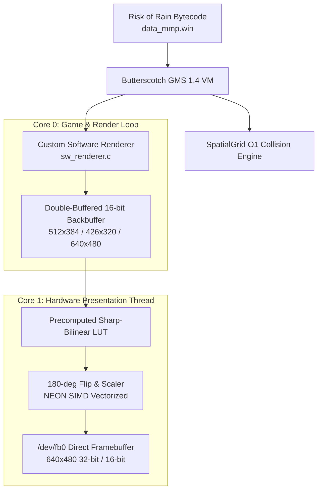

# Risk of Rain (2013) — Miyoo Mini Plus Native Port

[](https://github.com/OnionUI/Onion)
[](https://github.com/ButterscotchRunner/Butterscotch)
[]()
[]()
[](LICENSE)

Native embedded C/C++ port of the classic **Risk of Rain (2013)** for the **Miyoo Mini** and **Miyoo Mini Plus** running [OnionOS](https://github.com/OnionUI/Onion). Powered by a heavily customized and optimized build of the **Butterscotch** GameMaker: Studio 1.4 runtime, specially engineered for the SigmaStar SSD202D dual-core ARM Cortex-A7 SoC.

---

## Highlights & Technical Optimizations

* **Asynchronous Dual-Core Presentation Pipeline:**
  Rendering execution runs uninterrupted on **Core 0** while the 180° display rotation and scaling blit to `/dev/fb0` run asynchronously on **Core 1** with double-buffered zero-copy synchronization.
* **Precomputed Sharp-Bilinear Hardware Scaler:**
  Handheld zoom modes (**1.25X** at $512 \times 384$ and **1.5X** at $426 \times 320$) use precomputed lookup tables (LUT) with a **Sharp Bilinear** kernel. Keeps 100% solid, crisp pixel-art cores while smoothing the 1-pixel boundary zone to completely prevent blur and scrolling shimmer, with **0% runtime CPU cost**.
* **Tri-State Handheld Zoom (In-Game Menu):**
  Seamlessly switch between **1.0X** (640x480 full view), **1.25X** (512x384 handheld zoom), and **1.5X** (426x320 close-up combat) directly from the in-game *Video Options* menu. Settings automatically persist in `Prefs.ini`.
* **$O(1)$ SpatialGrid Collision Broadphase:**
  Replaced GameMaker's $O(N)$ linear instance collision scans with a 128px spatial hash grid, eliminating late-game CPU spikes during massive enemy swarms.
* **Rasterizer Fast-Paths:**
  * Dual-pixel packed 32-bit blending for alpha rectangle primitives (water bodies, environmental hazard zones).
  * Integer scanline midpoint LUT for small circles ($r \le 6$) replacing costly trigonometric math.
  * Direct C implementation of `instance_nearest_var` bypassing heap allocations for coin and orb magnet pickups.
  * LRU-capped floating damage numbers (`oEfDamage`, max 20 instances) to prevent late-game object pool exhaustion.
* **High-Efficiency Audio Engine:**
  Tremor integer-only Ogg Vorbis decoder feeding a 128 KB lock-free ring-buffer via an optimized SDL-1.2 sound backend.
* **Zero-Logging Launcher:**
  Eliminated disk I/O bottlenecks during gameplay by suppressing verbose terminal logging, preventing micro-stutters and extending SD card lifespan.

---

## Installation (Players — Bring Your Own Data)

This project strictly adheres to a **Clean-Room BYOD (Bring Your Own Data)** policy. No proprietary copyrighted game assets are included in this repository or release packages. You must provide your own legally purchased copy of Risk of Rain (2013) from Steam or GOG.

### Requirements
* Miyoo Mini or Miyoo Mini Plus with **OnionOS v4.2+** installed.
* A legally owned copy of **Risk of Rain (2013)** (Steam or GOG, PC version).

### Setup Instructions
1. Download the latest `Risk_of_Rain_MiyooMiniPlus.zip` from the [Releases](https://github.com/Fnava1/risk-of-rain-miyoo/releases) section.
2. Extract the archive directly to the root of your Miyoo Mini SD card. It will populate:
   ```text
   SDCARD/
   └── Roms/
       └── PORTS/
           ├── Games/
           │   └── Risk of Rain/
           │       ├── RiskOfRain
           │       ├── launch.sh
           │       ├── setup_miyoo
           │       ├── Prefs.ini
           │       └── libs/
           ├── Imgs/
           │   └── Risk of Rain.png
           └── Shortcuts/
               └── Action/
                   └── Risk of Rain.port
   ```
3. Copy your PC game files into `Roms/PORTS/Games/Risk of Rain/`:
   * `data.win`
   * All `.ogg` music and sound files (e.g. `musicStage1.ogg`, `musicBoss1a.ogg`, etc.)
4. Insert the SD card into your Miyoo Mini Plus, boot into OnionOS, go to **Games > Ports**, and launch **Risk of Rain**.
5. On the first launch, `setup_miyoo` will automatically optimize textures, configure default gamepad mappings, and initialize the game.

---

## Default Controls (Miyoo Mini Plus)

| Button | Action |
| :--- | :--- |
| **D-Pad Left / Right** | Move |
| **D-Pad Up / Down** | Climb Ladders / Ropes |
| **A** | Jump |
| **Y** | Primary Attack (Skill 1) |
| **L1** | Secondary Skill (Skill 2) |
| **R1** | Utility Skill (Skill 3) |
| **R2** | Special Skill (Skill 4) |
| **L2** | Use Equipment Item |
| **X** | Interact / Swap Item |
| **Select** | View Map / Zoom View |
| **Start / Menu** | Pause Menu (Escape) |

---

## Building from Source

### Prerequisites
* Docker (recommended for reproducible cross-compilation)
* Python 3.10+ (for unit test runner and asset tools)
* Git

### Compiling the Engine

1. Clone the repository:
   ```bash
   git clone https://github.com/Fnava1/risk-of-rain-miyoo.git
   cd risk-of-rain-miyoo
   ```

2. Build using the Miyoo cross-compilation Docker container:
   ```bash
   # Build Miyoo ARM binary
   docker run --rm -v "$(pwd):/root/workspace" riskrain-builder:latest bash -c \
       "cd /root/workspace/butterscotch/build_miyoo && make -j4 && \
        /opt/miyoomini-toolchain/usr/bin/arm-linux-gnueabihf-strip -s butterscotch -o /root/workspace/dist/Roms/PORTS/Games/Risk\ of\ Rain/RiskOfRain"
   ```

3. Assemble clean release distribution package:
   ```bash
   python tools/assemble_dist.py
   ```

---

## Running the Unit Test Suite

The project includes an extensive suite of **42 automated regression tests** covering clean-room compliance, zoom aspect ratios, Sharp Bilinear mapping mathematics, room classifications, and renderer fast-paths:

```bash
python -m unittest discover tests
```

---

## Architecture Overview



---

## Legal & Clean-Room Notice

* This project is an independent open-source port and runtime implementation.
* It is **not** affiliated with, endorsed by, or connected to Hopoo Games or Chucklefish.
* All original Risk of Rain (2013) game assets, code, music, and intellectual property belong to their respective copyright holders.
* Users must supply their own legally acquired game files.

---

## License

This project is licensed under the [MIT License](LICENSE).
Portions based on Butterscotch are licensed under their original project terms.
