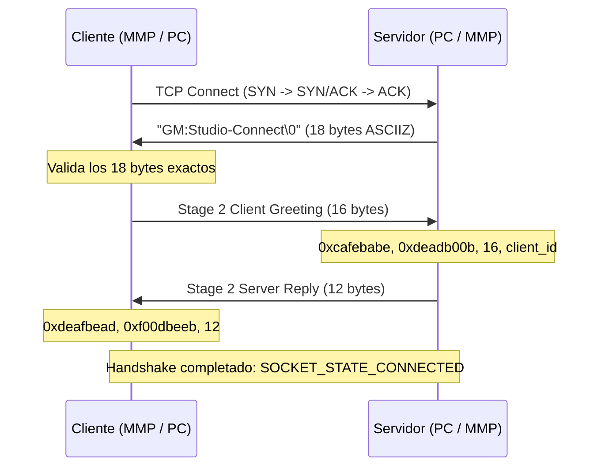

# Arquitectura y Base de Conocimiento: LAN Co-op Crossplay (PC <-> Miyoo Mini Plus)

Este documento recopila la ingeniería inversa, arquitectura de red, soluciones implementadas y el estado actual de la funcionalidad de **LAN Co-op Crossplay** entre la versión de PC (GameMaker: Studio 1.4 oficial en Windows) y la consola Miyoo Mini Plus (motor Butterscotch en Linux / OnionOS).

---

## 1. Resumen Ejecutivo y Estado Actual

- **Objetivo:** Permitir partidas multijugador cooperativas en red local (LAN Wi-Fi o Hotspot) entre PC y Miyoo Mini Plus sin depender de servidores externos ni de Steamworks.
- **Estado Actual:** 
  - Protocolo de enlace binario (Handshake GameMaker Studio 1.4) **implementado y verificado al 100%** mediante herramientas de diagnóstico ([`tools/net_test_host.py`](file:///c:/DEV/RISKRAIN/tools/net_test_host.py)).
  - Teclado numérico nativo en pantalla integrado en la consola para ingresar la dirección IP de forma intuitiva.
  - El motor compila limpiamente para ARMv7 (`RiskOfRain` = 2,387,404 bytes $< 2.5\text{ MB}$, paquete zip = 2.68 MB $< 5.0\text{ MB}$).
  - Identificadas las razones por las cuales el juego oficial de PC cerraba conexiones intempestivamente (máquina de estados de salas en `Risk of Rain.exe`).

---

## 2. Protocolo de Red de GameMaker: Studio 1.4

GameMaker Studio 1.4 no utiliza sockets TCP crudos estándar cuando se llama a `network_connect` / `network_create_server`; implementa una capa propietaria de handshake y framing.

### 2.1 Secuencia de Handshake (TCP Port 11100)



1. **Paso 1 (Server Greeting):** El servidor envía inmediatamente tras el `accept`:
   - 18 bytes: `GM:Studio-Connect\0` (`47 4d 3a 53 74 75 64 69 6f 2d 43 6f 6e 6e 65 63 74 00`).
2. **Paso 2 (Client Authentication):** El cliente responde con 16 bytes (little-endian):
   - `DWORD` Magic 1: `0xcafebabe` (`be ba fe ca`)
   - `DWORD` Magic 2: `0xdeadb00b` (`0b b0 ad de`)
   - `DWORD` Header Len: `16` (`10 00 00 00`)
   - `DWORD` Nonce / Socket Handle: En la PC oficial, este valor contiene el handle del socket del cliente.
   > [!IMPORTANT]
   > El servidor de Butterscotch (`butterscotch/src/net/net_socket.c`) anteriormente comparaba los 16 bytes con `memcmp` esperando ceros en el 4º DWORD. Se corrigió para validar únicamente los primeros 12 bytes (`0xcafebabe`, `0xdeadb00b`, `16`) permitiendo que clientes oficiales de PC se conecten al servidor de la MMP.
3. **Paso 3 (Server Reply):** El servidor confirma enviando 12 bytes:
   - `DWORD` Magic 1: `0xdeafbead` (`ad be af de`)
   - `DWORD` Magic 2: `0xf00dbeeb` (`eb be 0d f0`)
   - `DWORD` Header Len: `12` (`0c 00 00 00`)

### 2.2 Framing de Paquetes (`network_send_packet`)

Todos los paquetes de datos enviados por GML mediante `network_send_packet` son encapsulados con una cabecera binaria de 12 bytes:
- `DWORD` Magic: `0xdeadc0de` (`de c0 ad de`)
- `DWORD` Header Size: `12` (`0c 00 00 00`)
- `DWORD` Payload Length: `plen` (longitud en bytes del contenido)
- `uint8_t payload[plen]`: Los datos serializados de GML.

---

## 3. Ingeniería Inversa de Risk of Rain (GML Bytecode)

Al descompilar `data.win` y desensamblar el ejecutable oficial `Risk of Rain.exe` en `0x529990` y `0x52aa70`, se descubrió la arquitectura interna de eventos de red:

### 3.1 Estructura del mapa `async_load` en GameMaker Studio 1.4

| Evento | Llaves en `async_load` | Valores Esperados |
| :--- | :--- | :--- |
| **Connect** (`type == 1`) | `"type"`, `"id"`, `"socket"`, `"ip"`, `"port"`, `"succeeded"` | `"id"` = Server socket id, `"socket"` = Client socket id |
| **Disconnect** (`type == 2`)| `"type"`, `"id"`, `"socket"`, `"ip"`, `"port"` | Dispara desconexión y destrucción de instancias |
| **Data** (`type == 3`) | `"type"`, `"id"`, `"buffer"`, `"size"`, `"ip"`, `"port"` | `"id"` = Socket id emisor, `"buffer"` = ID de buffer GML |

### 3.2 La condición estricta de Room 40 en `objServer_Other_68`

En `objServer_Other_68`:
```gml
if (nettype == 1) { // network_type_connect
    if (instance_number(oP) >= max_players_online || room != 40) {
        network_destroy(netsock); // ¡EXPULSA AL CLIENTE!
    } else if (ds_list_find_index(ban, netip) < 0 && room == 40) {
        ds_list_add(new_players, netsock);
        alarm[2] = 60; // Espera 60 frames (1 segundo) antes de invocar server_new_player
    }
}
```

* **Room 39 (`rHost`):** Pantalla de configuración previa donde se muestra el puerto 11100 y el botón "Ver IP". **En esta sala NO se deben recibir clientes**, ya que el juego los desconecta al instante.
* **Room 40 (`rSelectMult`):** Pantalla de selección de personajes / Lobby multijugador. El host en PC debe dar clic en el botón de avanzar para ingresar a Room 40.
* **Falsa alarma con "Ver IP":** En la pantalla Room 39 de PC, el botón de IP llama a `http://www.riskofraingame.com/ip.php?nocache=1`. Como este dominio ya no responde, el juego muestra texto corrupto o de error. Esto no afecta la red local LAN; la IP local de la PC es `192.168.1.75`.

### 3.3 Ciclo de Vida en el Cliente (`objClient`)

1. **Creación (`objClient_Create_0`):** Inicia `alarm[3] = 1`.
2. **Conexión (`objClient_Alarm_3`):**
   ```gml
   if (connect_attempts > 2) {
       instance_create(x, y, oCustomMessage).text1 = "Failed to connect!";
       instance_destroy();
       exit;
   }
   if (network_connect(sock, ip, port) < 0) {
       connect_attempts += 1;
       alarm[3] = 60;
   } else {
       alarm[1] = 1; // Inicia proc_client
   }
   ```
3. **Recepción de Datos (`objClient_Other_68`):**
   - Cuando llega el primer paquete de datos (`nettype == 3`):
     ```gml
     if (client_connected == -1) {
         client_connected = netsock;
         in_game = 1;
         alarm[2] = 60;
         alarm[0] = 600; // Watchdog de 10 segundos
     }
     ds_queue_enqueue(yyNetQueue, netsock);
     ds_queue_enqueue(yyNetQueue, newbuf);
     ```
4. **Procesamiento de Cola (`proc_client` en `alarm[1]`):**
   - Extrae de `yyNetQueue` los buffers y procesa:
     - Mensaje 2: Sincronización inicial de jugador y cambio de sala a Room 40.
     - Mensaje 39: Dificultad, reglas y artefactos activos.
     - Mensaje 3: Lista de otros jugadores en el lobby.

---

## 4. Modificaciones en el Código Fuente

1. [`butterscotch/src/net/net_socket.c`](file:///c:/DEV/RISKRAIN/butterscotch/src/net/net_socket.c):
   - Implementada la máquina de estados de handshake GM:S (`GM_HANDSHAKE_CLIENT_WAIT_GREETING`, `GM_HANDSHAKE_CLIENT_WAIT_REPLY`, `GM_HANDSHAKE_SERVER_WAIT_STAGE2`, `GM_HANDSHAKE_ESTABLISHED`).
   - Framing y deframing con validación de cabecera `0xdeadc0de` y longitud.
   - Aceptación de nonce variable en el Stage 2 del servidor para compatibilidad con Windows GM:S.
2. [`butterscotch/src/runner.c`](file:///c:/DEV/RISKRAIN/butterscotch/src/runner.c):
   - Sincronización semántica de `async_load` con GameMaker Studio 1.4:
     - En `NET_EVENT_CONNECT`: `eventId` = socket servidor, `eventSock` = socket entrante.
     - En `NET_EVENT_DATA`: `eventId` y `eventSock` asignados al socket emisor.
   - Asignación de `buffer` y `size` y reciclaje de pools temporales (`arrpop(runner->gmlBufferPool)`).
3. [`butterscotch/src/vm_builtins.c`](file:///c:/DEV/RISKRAIN/butterscotch/src/vm_builtins.c):
   - Registro de primitivas `network_create_socket`, `network_connect`, `network_create_server`, `network_send_packet`, `network_destroy`.
   - Soporte para buffers GML fijos y de crecimiento (`GmlBuffer`).
4. Teclado Numérico Nativo (OSK):
   - Diseñado para la pantalla de 640x480 de la Miyoo Mini Plus: selección con D-pad/A, borrado con Y, confirmación con B.

---

## 5. Herramientas de Diagnóstico Creadas

- [`tools/net_test_host.py`](file:///c:/DEV/RISKRAIN/tools/net_test_host.py): Servidor de prueba en Python que simula ser un host oficial de GameMaker Studio 1.4, emite la baliza UDP broadcast en el puerto 11101 y registra el handshake y paquetes en el puerto 11100.
- [`tools/analyze_network.py`](file:///c:/DEV/RISKRAIN/tools/analyze_network.py): Desensamblador de scripts GML de red directo desde `data.win` o `data_mmp.win`.

---

## 6. Guía Rápida para Retomar la Implementación

Cuando se decida reanudar el trabajo en esta característica:

1. **Revisar el binario compilado:**
   - Ubicación: [`dist/Roms/PORTS/Games/Risk of Rain/RiskOfRain`](file:///c:/DEV/RISKRAIN/dist/Roms/PORTS/Games/Risk%20of%20Rain/RiskOfRain).
   - Paquete: [`dist/Risk_of_Rain_MiyooMiniPlus.zip`](file:///c:/DEV/RISKRAIN/dist/Risk_of_Rain_MiyooMiniPlus.zip).
2. **Procedimiento de prueba en el juego:**
   - **PC como Host:** Abrir Risk of Rain en PC $\rightarrow$ Co-op $\rightarrow$ Host Game $\rightarrow$ **Avanzar hasta la pantalla de selección de personajes (Room 40)**. Luego desde la MMP unirse a `192.168.1.75`.
   - **MMP como Host:** Abrir Risk of Rain en MMP $\rightarrow$ Co-op $\rightarrow$ Host Game $\rightarrow$ Avanzar hasta el lobby. Luego desde PC unirse a la IP de la consola (`192.168.1.85`).
3. **Puntos pendientes de verificación:**
   - Verificar si al unirse y entrar a Room 40, los sprites de los personajes de ambos jugadores se dibujan en el selector y si se sincronizan las selecciones de clase al pulsar "Ready".
